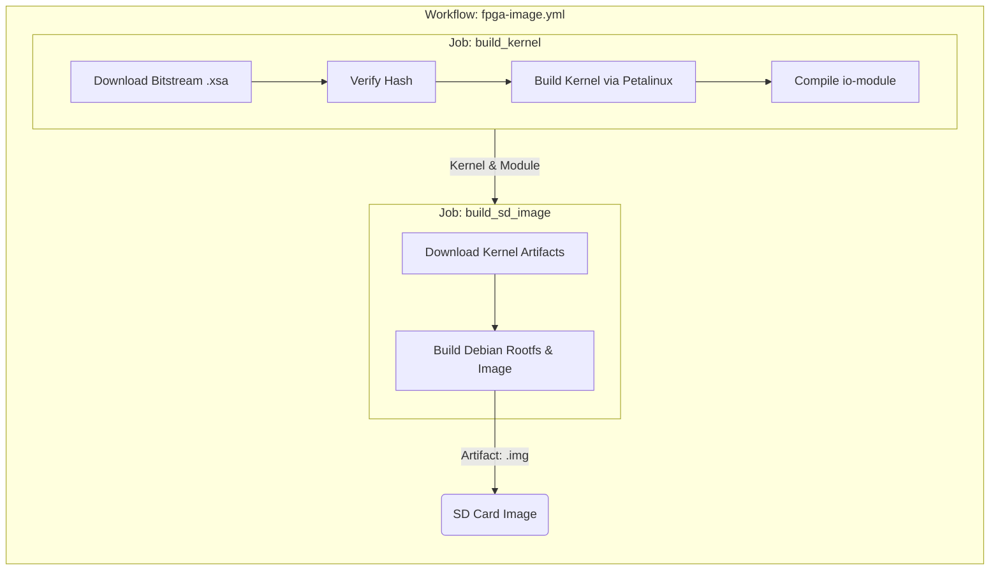
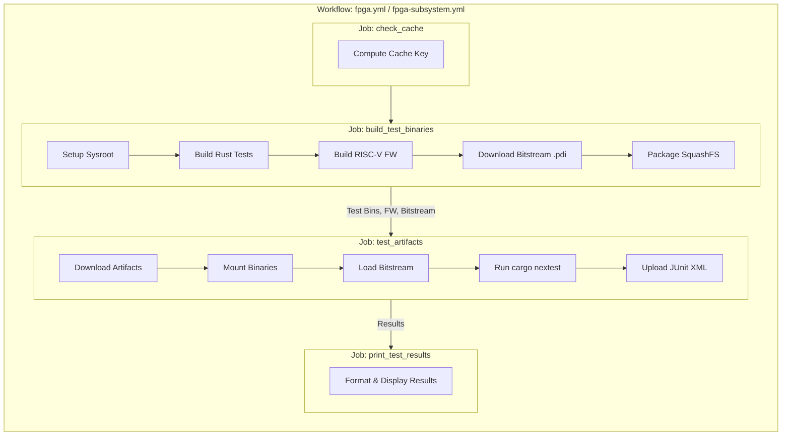

# FPGA CI Workflow

The Caliptra CI infrastructure utilizes FPGA emulation to verify hardware and firmware interactions on real hardware. This process involves building a bootable SD card image for the FPGA and then running specific test suites on it.

## Building 2.2 Bitstreams

Core bitstream production uses two workflows:

- `.github/workflows/bitstream-build_2.2.yml` is the 2.2 entry point. It runs on
  relevant pull requests targeting and pushes to `caliptra-2.2-dev`, and supports
  manual dispatch.
- `.github/workflows/bitstream-build.yml` is the reusable builder. The caller
  explicitly supplies the hardware version, source commit, RTL directory
  selector, and manifest-update target branch. The 2.2 caller selects `hw/latest`
  from the pinned source commit; `latest` is a directory selector, not a hardware
  version.

After the workflow is available on GitHub, dispatch a core build with:

```sh
gh workflow run bitstream-build_2.2.yml \
  --repo chipsalliance/caliptra-sw --ref caliptra-2.2-dev
```

Manual dispatch requires the entry workflow to be registered on the repository's
default branch as well. The push trigger can build changes merged into
`caliptra-2.2-dev` without that registration.

The builder produces standard and segmented artifacts with `2.2` in their names.
The segmented build must contain a runtime PDI. Its manifest records the actual
checked-out source commit, subsystem RTL commit, hardware version, and target
branch. On non-PR runs, only the segmented bundle is left for the builder runner's
post-job hook to publish to GCS at `v1/<source-commit>/core/manifest.toml`. Uploading a
GitHub Actions artifact alone does not publish it to GCS.

PR runs build the merge revision and upload the standard and segmented GitHub
artifacts for pre-merge validation. Both bundles are removed from the checkout
after artifact upload, including on failure, so they are not left for the
publication hook. The manifest-update job is skipped for PR events. Maintainers
must verify the runner hook honors this bundle-removal contract and require
approval before running fork PR code on the self-hosted builder; a read-only
workflow token does not isolate persistent runner credentials or state.

On non-PR runs, once the published manifest is available, the workflow opens a PR against
`caliptra-2.2-dev` updating `hw/fpga/bitstream_manifests/core.toml`. If publication
does not complete within 30 download attempts, the job fails without replacing
the existing manifest or opening a PR. The GitHub Actions configuration must
allow the workflow token to create pull requests.

Subsystem bitstreams are built in `chipsalliance/caliptra-mcu-sw` by
`.github/workflows/bitstream-build_2.2.yml` on `caliptra-mcu-dev-2.2`. Use its
generated segmented manifest for a subsequent subsystem manifest-update PR;
there is no second subsystem builder in this repository.

### Consuming the 2.2 bitstreams

The committed core and subsystem manifests select segmented 2.2 PDIs. Published
objects use `v1/<source-commit>/<core|subsystem>/`; the embedded manifest in a
GitHub bundle has hashes and provenance but no download URLs. Use the published
manifest, and verify the PDI and XSA SHA-256 hashes before updating a pin.

The FPGA test workflows accept `hw-version: "2.2"` or `"latest"`, both selecting
`hw/latest` and the 2.2 register model. They do not append `hw-2.2` Cargo features.
Other hardware versions are rejected before test artifacts are built. The
`cargo xtask ci check-bitstream <manifest> <core|subsystem>` check rejects the
wrong hardware version, variant, source repository/branch, non-segmented builds,
and missing PDI URLs or hashes. The downloader verifies the PDI hash.

Subsystem testing pins `CALIPTRA_MCU_COMMIT` to the MCU source used to build the
selected subsystem bitstream. Overrides must belong to `caliptra-mcu-dev-2.2`
and require compatibility testing. Both ROM and fuse definitions come from that
pin; the fuse file is `hw/latest/fuses.hjson`.
The MCU ROM build passes that checkout-local file through
`CALIPTRA_MCU_FUSES_HJSON`, so its pinned nested `caliptra-sw` does not attempt
to download the obsolete `hw/fuses.hjson` path.
This MCU revision uses
`CALIPTRA_HW_REV=latest` rather than `2.2` and names its generated ROM
`latest-caliptra-mcu-rom-fpga-core_test,ocp-lock.bin`. The workflow copies it to
the stable test-artifact name `mcu-rom-fpga.bin`.

The two pinned manifests currently reference the same subsystem RTL commit.
Their source commits and the MCU firmware pin are intentionally immutable;
updating a source branch does not update a running board's hardware.

### Hardware validation handoff

Before enabling 2.2 nightly FPGA jobs:

1. Verify the runner's static boot configuration, device tree, UIO mappings,
   and kernel modules are compatible with the new segmented PDI. The
   `fpga-image.yml` XSA pins are separate from these runtime manifests and have
   not been migrated; rebuild/provision boot images if needed.
2. Run core smoke/version tests and subsystem MCU boot/recovery tests, then the
   core and subsystem FPGA suites. Check OCP LOCK and flash/streaming boot
   configurations where supported.
3. Coordinate the ROM/runtime/FIPS hardware-expectation fixes with the nightly
   PR so they expect revision `0x22` without duplicate changes.
4. Enable the guarded nightly FPGA jobs only after hardware validation passes.

Updating manifests and building firmware does not by itself establish board
compatibility. Historical 2.1 ROM matrices are not certified by this migration.

### Current hardware validation blockers

Software now pins Caliptra-SS `e5d96a262b937b913fbcda3f681003f510baacff`,
which pins the corrected core release `v2.2-rc1`
(`4e7becc76daaf69124192560fe580363d6a22a98`). This release uses the `dcls_en`
core port; standalone wrappers tie it low.

The initial pinned core and subsystem bitstreams still report hardware generation
`0x12`: their pinned `soc_ifc_reg.sv` returns that value for `CPTRA_HW_REV_ID`.
The 2.2 tests expect `0x22`. Rebuild both bitstreams from the corrected release
and update their manifests rather than changing expectations or relabeling the
old artifacts. The manifest pins remain unchanged until new artifacts exist.

The standalone core wrapper also needs rebuilding after converting the host's
one-bit debug-lock control to the RTL's MuBi4 representation. The host register
layout is unchanged. The initial core CI run reported debug locked even for
unlocked test inputs, and its 40-million-cycle watchdog expired during MLDSA KAT.
Revalidate reset/security state and KAT completion on the rebuilt core before
selecting a new watchdog budget.

The Verilator harness uses the design-only `caliptra_top.vf` source list plus
the testbench package and VEER SRAM model required by its custom top. It uses
the pinned `abr_mem_top` implementation for the current masked memory banks.
The host-facing TRNG and security-state interfaces remain unchanged; the harness
maps entropy to source 0, disables source 1, and encodes debug lock as MuBi4.

## 1. Building the FPGA Image

The FPGA image creation is handled by the workflow defined in `.github/workflows/fpga-image.yml`. This workflow produces the necessary artifacts to boot the Xilinx VCK190 evaluation kit.



### Workflow: `fpga-image.yml`

This workflow runs on a schedule (Tuesday/Thursday) or when changes are made to FPGA-related files. It creates two variants of the image: `core` and `subsystem`.

#### **Job: `build_kernel`**
- **Purpose:** Builds the Linux kernel and modules tailored for the VCK190 board with the Caliptra bitstream.
- **Key Steps:**
    1.  **Downloads the Bitstream:** Fetches the specific `.xsa` (Xilinx Support Archive) file (either `core` or `subsystem` variant) from a Google Cloud Storage bucket.
    2.  **Verifies Hash:** Ensures the downloaded bitstream matches the expected SHA256 hash.
    3.  **Builds Kernel:** Uses Petalinux tools (mounted from a pre-configured volume) to build the kernel (`BOOT.BIN`, `Image`, `image.ub`, etc.).
    4.  **Compiles Modules:** Builds the custom `io-module` kernel driver.
    5.  **Artifacts:** Uploads the kernel tarball (`vck190-kernel-*.tar.gz`) and the kernel module (`io-module-*.ko`) as artifacts.

#### **Job: `build_sd_image`**
- **Purpose:** Packages the kernel and a Debian-based root filesystem into a bootable SD card image (`.img`).
- **Key Steps:**
    1.  **Downloads Kernel:** Retrieves the artifacts from the `build_kernel` job.
    2.  **Builds Image:** Uses a script (`ci-tools/fpga-image/build.sh`) to assemble the final image. This process involves:
        - Setting up a Debian filesystem (using `debootstrap`).
        - Installing the kernel and modules.
        - Configuring boot scripts.
    3.  **Artifacts:** Uploads the final SD card image (`caliptra-fpga-image-*.img`) as an artifact.

---

## 2. Running FPGA Tests

Once the infrastructure is ready, tests are executed on the FPGA hardware using self-hosted runners connected to the physical boards.



### Workflow: `fpga.yml` (Core Tests) & `fpga-subsystem.yml` (Subsystem Tests)

These workflows are triggered by pull requests or the nightly release process. They follow a similar structure:

#### **Job: `check_cache`**
- **Purpose:** Optimizes build times by checking if valid artifacts already exist for the current commit.
- **Key Steps:** Computes a unique cache key based on the git tree hash of the FPGA source code and RTL.

#### **Job: `build_test_binaries`**
- **Purpose:** Cross-compiles the test binaries and firmware for the FPGA's AArch64 architecture.
- **Key Steps:**
    1.  **Sysroot Setup:** Restores or builds a Debian sysroot for cross-compilation.
    2.  **MCU ROM:** (Subsystem only) Builds the MCU ROM firmware.
    3.  **Test Binaries:** Compiles the Rust test suite using `cargo nextest archive` with specific features (e.g., `fpga_realtime` or `fpga_subsystem`).
    4.  **Firmware:** Builds the Caliptra firmware (ROM, FMC, Runtime) for the RISC-V target.
    5.  **Bitstream:** Downloads the appropriate bitstream (`.pdi` file).
    6.  **Packaging:** Compresses the test binaries into a squashfs image (`caliptra-test-binaries.sqsh`) to save space and transfer time.

#### **Job: `test_artifacts` / `test_artifacts_subsystem`**
- **Purpose:** Executes the tests on the physical FPGA board.
- **Runner:** Runs on self-hosted runners (`vck190` or `vck190-subsystem`).
- **Key Steps:**
    1.  **Downloads Artifacts:** Retrieves the test binaries, firmware, and bitstream.
    2.  **Mounts Binaries:** Mounts the squashfs image containing the tests.
    3.  **Loads Bitstream:** Flashes the FPGA with the bitstream using the FPGA manager.
    4.  **Executes Tests:**
        - Runs `cargo nextest` to execute the tests.
        - Tests communicate with the Caliptra hardware via the `uio` driver and memory-mapped IO.
        - Tests are partitioned to run in parallel across multiple runs if configured.
    5.  **Uploads Results:** Saves the JUnit XML test results for reporting.

#### **Job: `print_test_results`**
- **Purpose:** Aggregates and displays the test results in the GitHub Actions summary.
- **Key Steps:** Downloads the XML results and uses a custom tool (`test-printer`) to format the output.

---

## 3. The FPGA Startup Script

The behavior of the FPGA image upon boot is controlled by `ci-tools/fpga-image/startup-script.sh`. This script is crucial for setting up the environment for the GitHub Actions runner.

### Key Functions:

1.  **Overlay File System Setup:**
    - To allow modifications to the read-only root filesystem (common in embedded images), the script creates an `overlayfs`.
    - It mounts a `tmpfs` (RAM disk) over the root `/`. This ensures that any changes made during the session (like installing packages or downloading artifacts) are discarded upon reboot, keeping the base image clean.
    - It uses `pivot_root` to switch to this new overlay system and recursively calls itself to proceed with the boot process.

2.  **Network & Time Configuration:**
    - Sets a random MAC address for the ethernet interface to avoid conflicts on the network.
    - Waits for a network connection (pinging google.com).
    - Syncs the system time via NTP, which is essential for SSL/TLS connections used by the GitHub Actions runner.

3.  **Kernel Module Loading:**
    - Inserts the `io-module.ko` kernel module. This custom driver is responsible for handling communication between the Linux userspace and the Caliptra hardware logic (via UIO).

4.  **Communication with Host (`fpga-boss`):**
    - The script prints a "sentinel" string (`36668aa492b1c83cdd3ade8466a0153d --- Command input`) to the serial console (UART).
    - This signals to the host machine (running `fpga-boss`) that the FPGA is ready to receive commands.
    - It waits for input, primarily the `runner-jitconfig` command.

5.  **Executing the Runner:**
    - When it receives the `runner-jitconfig` command with a base64-encoded token, it launches the GitHub Actions runner (`run.sh --jitconfig ...`).
    - This registers the FPGA as a self-hosted runner for the repository, allowing it to pick up jobs from the `fpga.yml` workflow.

6.  **Cleanup:**
    - Once the runner completes its job, the script emits a completion sentinel (`3297327285280f1ffb8b57222e0a5033 --- ACTION IS COMPLETE`).
    - This tells the host controller that the job is done, and the board can be power-cycled or reset for the next run.